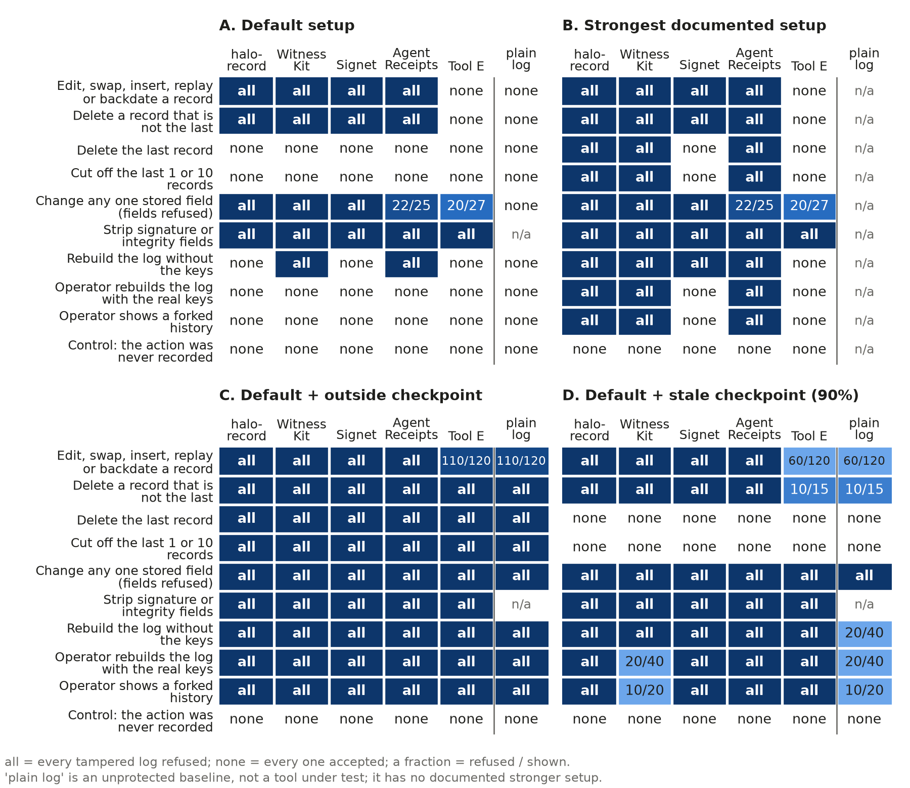

# ReSeal: Do Tamper-Evident Agent Logs Hold Up Against Their Own Operator?

Eleazar Ekhosu (Independent researcher)

With Apart Research. Research conducted at the AI x Epistemics Research Sprint, November 13 to 15, 2026.

## Abstract

Open-source tools now promise "tamper-evident" logs of what an AI agent did, and ship a verifier that prints a pass verdict. We test whether that verdict changes when the log is changed. ReSeal records one seeded agent workload through five such tools and an unprotected baseline, applies 14 kinds of tampering, and asks each tool's own verifier to judge the result, in its default setup and in its strongest documented setup. Outcomes are deterministic, so the evidence is 864 distinct test cells, each repeated over five seeds and re-checked at a second log length. Each tool's documented claims are coded twice, independently, and compared with what its verifier did. Four of five tools refuse every edited, reordered, inserted or backdated record. In the default setup all five accept a truncated log, a log rebuilt by the operator with the real keys, and a forked history. Three refuse these once a head hash or record count is held outside the operator. One has no verifier option for that, and one accepts altered records outright and is reported unnamed. We then add a small, tool-agnostic outside checkpoint, a record count and a prefix digest. With it every tool, and even the unprotected baseline, refuses all tampering that falls before the checkpoint. A pass verdict from a default setup shows that a log is consistent with itself, not that it is the log that was written. The missing layer is small, and it has to live outside the operator.

## 1. Introduction

When an AI agent takes a consequential action, the operator's own log is usually the only record of it. This sprint's Track 2 brief puts it the same way and asks: "What minimal tamper-evident layer is missing from today's AI observability standards?" [12]. Open-source tools already offer an answer. They chain records with hashes, sign them, and ship a verifier that prints a verdict.

A green "verified" is itself a claim about the world. It is only worth trusting if the verifier would have said something different had the log been changed. That is an empirical question. So far each tool has answered it only for its own design [1].

This matters for AI safety because agent logs are evidence. Incident review, oversight of deployed agents and audits against safety commitments all rest on records the audited party holds. The party with the strongest reason to change a log is the operator, who also holds the storage and the signing keys.

**Threat model.** We test five kinds of attacker. An *outside editor* changes stored records and does not repair integrity fields. A *re-sealer* rebuilds the whole log with the tool's own library but without the original keys. The *operator* rebuilds the log with the real keys. A *forking operator* shows a different history that shares a prefix with the real one. The last case is a control: the action never reached the recorder. We assume the cryptography is sound and attack only logs we generated ourselves.

**Contributions.**

1. ReSeal, an open harness that records one seeded agent workload through each tool's own API, applies 14 kinds of tampering, and asks the tool's own verifier for a verdict.
2. A head-to-head measurement of five shipped tools and a baseline under the same attacks. To our knowledge it is the first to run each tool's own verifier against one tampering suite.
3. A claims-versus-behaviour comparison, coded twice, giving one Claims Card per tool.
4. A tested answer to the Track 2 question: a count and a prefix digest held outside the operator close every gap we measured, for every tool, up to the last checkpoint.

## 2. Related Work

**Single-system evaluations.** Agent Flight Recorder [1] combines hash chaining, Merkle batching and on-chain anchoring. It reports that edit, delete, reorder and fork tampering are all detected, at about 48 microseconds of added median latency per event. It injects each attack at ten positions in one log, evaluates only its own system, and leaves comparison against deployed alternatives to future work. We reuse the idea of varying the position, and add truncation, key-holder rewrites and a field-by-field sweep.

**Conformance suites.** Prakash [9] scores four vendors' agent-governance artifacts against an open receipt specification. Adapters translate each vendor's artifact into that specification; the vendors' own verifiers are not run, and no tampering campaign is reported. Sharif's conformance corpus [10] offers 184 test vectors, each with one planted defect, for verifiers of one draft format [3]. Both test conformance to a format. ReSeal tests what shipped verifiers accept.

**Conceptual limits.** Zhao et al. [2] argue that a claim about an agent is auditable only when its policy, its scope, the records that would settle it and a decision rule are fixed before any verdict. They note that verification authenticates the entries it is given and, without an independent checkpoint, cannot rule out a rewritten chain. That an operator can rewrite a self-held chain is therefore known in principle. What was not known is which shipped tools close the gap, which say so, and how little it takes.

**Formats and standards.** An individual IETF draft [3] defines an agent audit record format in which hash chaining is required while signatures, external timestamps and Merkle batch anchoring are optional. RFC 9943 [4] defines transparency services that issue receipts for signed statements and names non-equivocation as a requirement. OpenTelemetry's GenAI conventions [11] define agent and tool spans; at the commit we read they contain no integrity, digest or checkpoint attribute.

**The gap.** Searches of arXiv, GitHub, PyPI and the web on 8 and 13 November 2026 found no study that runs shipped tools' own verifiers against one tampering suite, and none that sets a tool's documented claims against its verifier's behaviour. ReSeal does both.

## 3. Methods

**Tools.** We test five open-source tools that claim tamper-evidence for agent records, ship a verifier that runs offline, and install from PyPI: halo-record 0.2.47 [5], WitnessKit 0.1.0 [6], Signet (signet-auth 0.11.0) [7], Agent Receipts (obsigna 0.16.0) [8], and a fifth tool reported as Tool E. Tool E is unnamed because its result looks like a defect and its maintainer has not been contacted (Appendix A). These are young projects, and we make no claim about how widely they are used. A sixth column is a *baseline*: a plain JSON-lines log whose "verifier" accepts any file that parses. Agent Flight Recorder [1] is not on a package index and could not be installed in our environment, so it was read but not run.

**Adapters.** One adapter per tool calls only that tool's public recording and verifying code. A verdict of "accepted" means the verifier vouched for the log. Any refusal counts as detected, including an explicit "cannot vouch" and a verifier that cannot parse the tampered file.

**Three setups.** *Default* is what the quick start gives. *Strong* is the strongest verification the tool documents, with the extra state held outside the attacker's reach (Table 1). *Checkpoint* is the default verifier plus the ReSeal checkpoint described below. Attacks never touch outside state.

| Tool | Default setup | Strong setup adds |
| --- | --- | --- |
| halo-record | Hash-chain check | Witness checkpoint (record count, head, root) held outside the operator |
| WitnessKit | Chain and signature check with the issuer key pinned | Expected head hash held outside |
| Signet | Chain check and signature check, no pinned key | Agent public key pinned |
| Agent Receipts | Chain and signature check against a given public key | Expected length and final hash held outside |
| Tool E | Per-receipt proof check | Nothing: no stronger offline setup is documented |

*Table 1. What each setup verifies. The strong setups are not like for like: Signet's adds a key but no state about the log's length or head, because its audit verifier takes none. The checkpoint setup gives every tool the same outside state.*

**The ReSeal checkpoint.** Two values are kept by someone other than the operator: a record count *n*, and a running SHA-256 digest over the first *n* records in order (d0 is 32 zero bytes; dk = SHA-256(dk-1 || SHA-256(record k as canonical JSON))). A presented log passes if it has at least *n* records and its first *n* give the same digest. It needs no keys and knows nothing about the tool. It is about 40 lines of code (`reseal/checkpoint.py`). We test it taken after the last record, and taken *stale*, after the first 90% of the log.

**Workload.** A seeded generator produces 1,000 agent events per run (tool calls, model calls, file writes, approvals, delegations, each with a policy verdict). The same events are recorded through every tool.

**Attacks.** Fourteen attacks, A1 to A14 (Appendix C maps them to Figure 1's rows). Nine edit stored records: change an argument, flip a policy verdict, delete, truncate, swap, insert, replay, backdate, or strip integrity fields. One changes every stored field of one record, one field at a time. Two rebuild the whole log through the tool's own recorder, without and with the real keys. One forks the history. The last is the control. Positional attacks run at the first, middle, penultimate and final record.

**Benign controls.** Five harmless changes measure false alarms: a load and re-save through our harness, a file copy, CRLF line endings, re-serialised JSON, and a trailing newline.

**Unit of evidence.** Verifiers are deterministic. One *cell* is one tool, setup, attack, variant and position. Five seeds and a second log length (100 events, five other seeds) are replicates that test whether an outcome depends on content or length. They are not independent samples, so we report exact counts and no significance tests.

**Claims coding.** For each tool we saved the README packaged with the tested version, plus the limits or security document that README points to. Each statement about tampering was coded as property, attacker and strength: *claims*, *claims with setup*, or *disclaims*. No statement means *silent*. Two coders worked from a written codebook. Coder 1 was the AI assistant that built the harness, and it had seen pilot results. Coder 2 was a separate instance of the same model that was given only the codebook and the saved documents, with no access to code or results. We report Cohen's kappa on the governing statement for each tool and property (55 cells), and we report every disagreement.

**Labels.** Each tool, property and setup gets one label. *Claim holds*: the documentation claims detection and the verifier detects. *Disclosed limit*: the documentation says the tampering is not detected, or needs extra setup, and it is missed. *Caught, not claimed*: detected although the documentation is silent or disclaims it. *Silent miss*: missed and never mentioned. *Claim not met*: the documentation claims detection and the verifier accepts the log. Where a headline and a specific statement disagree, the specific one governs. Because that rule matters, we also report a *strict reading*, in which any unconditional claim governs and deleting the last record counts as deletion, not truncation.

**Harness checks.** @@TESTS@@ tests assert properties of ReSeal itself: clean logs verify, every attack changes the file, the field sweep changes exactly one field, attacks never touch the original or the outside state, the checkpoint accepts a log that only grew, and every coded quote appears word for word in the saved documentation.

**What did not work.** Signet offers server co-signed receipts, which looked like a stronger setup. Its Python SDK refuses to append them to the audit log (a type error), so they are not part of the audit log's verification and were left out.

## 4. Results

The main run covers 864 cells (default and strong setups), each run on five seeds: 4,212 trials, of which 30 are benign controls that do not apply to a tool's file format. Every clean log was accepted before any attack ran. No cell changed outcome between seeds, and the 100-event run agreed with the main run in all 840 cells they share. No benign control raised a false alarm in any setup (0 of 220 applicable trials in the main run, 0 of @@CTL_LAYER@@ in the checkpoint run). The checkpoint run adds @@LAYER_TRIALS@@ trials.

### 4.1 What the verifiers did

**Outside editor.** In the default setup, four tools refused every log with an edited, swapped, inserted, replayed, backdated or stripped record. Tool E accepted every edited, swapped, inserted, replayed and backdated log. Deletion depends on position: the same four tools refused a deletion at the first, middle or penultimate record and accepted deletion of the final record. All five tools accepted a log with its last 1 or last 10 records cut off. The unprotected baseline accepted everything, as it must.

**Rebuild without the keys.** WitnessKit and Agent Receipts refused every rebuilt log, because their quick start already takes the issuer's public key. halo-record and Signet accepted every one. halo-record's chain is unsigned, and its README says so. Signet's default checks use the public key carried inside each receipt.

**Operator.** In the default setup all five tools accepted every log rebuilt with the real keys and every forked history. In the strong setup halo-record, WitnessKit and Agent Receipts refused all of them, and also refused truncation. Signet's strongest documented setup, a pinned key, cannot help against the key holder and still accepted truncation. Tool E has no stronger setup.

**Field coverage.** halo-record, WitnessKit and Signet refused a change to any stored field. Agent Receipts accepted changes to three fields inside its proof block (creation time, purpose, key reference). Its README notes that the receipt hash excludes the proof block, so this is a design choice, and the receipt's own time and issuer fields are covered. Tool E accepted changes to 7 of its 27 stored fields: agent identifier, index, query hash, response hash, root hash, timestamp and tool name. It also accepted a record with its integrity fields stripped when that record was the first one.

**Control.** No setup flagged an action that was never recorded, as expected.

*Figure 1. What each tool's own verifier refused. Left: default setup. Middle: strongest documented setup. Right: default setup plus the ReSeal checkpoint, taken after the last record. Each cell pools five seeds; a fraction is tampered logs refused out of tampered logs shown, and for the field sweep it is fields.*

### 4.2 The outside checkpoint

With a checkpoint taken after the last record, every tool refused every tampered log in every attack except the control (Figure 1, right). That includes Signet, whose own verifier has no option for it, Tool E, and the unprotected baseline. @@CP_SENTENCE@@

A checkpoint protects only what it covers. With the stale checkpoint, taken after the first 90% of the log, tampering at the first or middle record was still always refused. Tampering in the uncovered tail fell back to the tool's own default check: @@STALE_SENTENCE@@ The window between checkpoints is therefore the real design parameter, and it is set by how often the outside party is given a new count and digest.

### 4.3 Claims versus behaviour

The two codings agreed on @@AGREE@@ of 55 cells (Cohen's kappa @@KAPPA@@). @@KAPPA_SENTENCE@@ Table 2 uses coder 1's sheet; Appendix C lists every cell where coder 2 differs.

| Tool | Claim holds | Disclosed limit | Caught, not claimed | Silent miss | Claim not met |
| --- | --- | --- | --- | --- | --- |
| halo-record | 3 | 5 | 3 | 0 | 0 |
| WitnessKit | 6 | 2 | 1 | 2 | 0 |
| Signet | 3 | 4 | 3 | 1 | 0 |
| Agent Receipts | 3 | 1 | 4 | 3 | 0 |
| Tool E | 0 | 0 | 0 | 9 | 2 |

*Table 2. Default setup: eleven kinds of tampering per tool, labelled by what the documentation says and what the verifier did. Appendix C has the strong setup and the quotes.*

For the four named tools, no claim failed under the main rule. Their 18 default-setup misses split into 12 that the documentation discloses and 6 it does not mention: a forked history (WitnessKit, Signet, Agent Receipts), capture omission (WitnessKit, Agent Receipts) and truncation (Agent Receipts).

Under the strict reading, three more claims are not met in the default setup. All three are deletion claims that fail on the final record: WitnessKit ("Delete an entry | sequence-number gap + broken prev_hash link"), Signet ("Delete or reorder entries and the SHA-256 hash chain breaks.") and Agent Receipts ("The receipt chain shows exactly which actions it took, in what order"). In the strong setup only Signet's remains. Signet's security page does say that truncation is "Detectable if expected record count is known", but its audit verifier takes no expected count, so keeping and comparing it is left to the user.

Tool E's README says, in paraphrase, that each call gets a proof that cannot be forged or altered afterwards. Its verifier accepted altered records and logs rebuilt without the original keys. These two claims fail under either reading.

### 4.4 Hypotheses

| | Hypothesis (written 8 to 9 Nov) | Result |
| --- | --- | --- |
| H1 | Defaults catch naive edits but accept an operator rewrite; catching it needs state held outside the operator | Supported. 4 of 5 catch naive edits, 5 of 5 accept the rewrite, 3 of 5 refuse it with their own outside state, 5 of 5 with the checkpoint |
| H2 | Truncation and final-record deletion are the most common misses without outside state | Supported. They are the only outside-editor misses of the four tools that catch edits, and all five miss them |
| H3 | Headline wording claims more than the tool's own limits section | Partly. Clear for Signet and Tool E. halo-record and WitnessKit put the limit next to the headline |
| H4 | At least one verifier accepts a changed stored field or stripped integrity fields | Supported. Tool E (7 fields), Agent Receipts (3 proof-metadata fields, by design) |

*Table 3. Hypotheses committed before the reported run, and outcomes.*

## 5. Discussion and Limitations

**What is new here.** That a self-held chain cannot stop its key holder is known [2], and the better-documented tools say so. The measurements add three things. First, which shipped tools close the gap and which do not: three can, one cannot, one fails earlier. Second, where documentation and behaviour part: mostly in silence about forks and the final record, and in one tool outright. Third, how small the missing layer is. A count and a digest held by a second party gave an unprotected log the same refusals as the best tool.

**For people who rely on agent logs.** Ask who holds the head. A verify result that uses only what the operator stores is evidence against an outside editor and nothing more.

**For tool builders.** Print what was not checked next to the pass verdict; halo-record already does. Put the expected head or count in the quick start. Say on the first screen that the default cannot see truncation or a fork.

**For standards.** A format that requires chaining and leaves anchoring optional [3] describes the default setups we tested. For telemetry, the two checkpoint values could ride on existing spans as a periodic event sent to a collector the operator does not control. `docs/OTEL_MAPPING.md` sketches this for the OpenTelemetry GenAI conventions [11]. We did not test it with an OpenTelemetry SDK; the plain-log baseline with a checkpoint is the tested stand-in.

**Limitations.**

- Five tools, one version each, chosen by us from tools with an offline verifier on PyPI. Hosted services and other language SDKs are untested, and we have no adoption data.
- The workload is synthetic. The results describe verifiers, not real deployments.
- Outside state is assumed honest and intact. We do not test an attacker who can replace it, key theft, or the cryptography. The checkpoint moves trust to whoever holds it.
- Both claim coders are instances of one AI model. Coder 2 was blind to code and results but is not a human reader, and no human coded the documents independently.
- Outcomes are deterministic. There is no sampling error, and also no claim beyond these versions and these attacks.
- Tool E is unnamed, so readers cannot reproduce its column yet. A SHA-256 commitment to its adapter is published so the later release can be checked, and the sprint organisers can have the name and adapter on request (Appendix A).
- We did not measure cost or latency, and Agent Flight Recorder, the closest prior system, was not run.

**Future work.** A human claims coder. More tools, including hosted ones and Agent Flight Recorder. Attacks on the checkpoint holder. The telemetry mapping, built and tested.

## 6. Conclusion

We ran one tampering suite against five open-source agent audit-log tools and compared each verifier with its own documentation. Four of the five catch every naive edit. In the default setup all five accept a truncated log, a log rewritten by the operator, and a forked history. Three of them refuse all of these once a head hash, a count or a checkpoint is held by someone else, and with a 40-line outside checkpoint all of them do, as does a log with no protection at all.

A "verified" result is only as strong as the state the verifier holds that the operator does not. That state is two numbers. ReSeal makes the question testable: a new tool needs one adapter to get its own column and its own Claims Card.

## Code and Data

Code, the claims sheets, saved documentation snapshots and every trial are in the project repository: github.com/0xNexuz/reseal. It leaves out the Tool E adapter until that tool's maintainer has been told (Appendix A). The file `results/REPORT_NUMBERS.md` recomputes every number in this report from the trial files. No dataset with personal data is used; the workload is synthetic.

## Author Contributions

E.E. entered the sprint, directed the work, decided how the unnamed tool's result would be handled, and reviewed and approved this report. The hands-on work was done with an AI assistant, as the LLM Usage Statement describes.

## References

[1] L. Bindschaedler, Q. Botha, C. Siebenbrunner. Agent Flight Recorder: Tamper-Evident Audit Trails with On-Chain Anchoring for Long-Horizon Tool-Using Agents. arXiv:2609.01931, 2026. https://arxiv.org/abs/2609.01931

[2] Y. Zhao, J. Li, L. Li, Y. Nian, J. Liu, X. Zhou, X. Hu. Auditable Claims about AI Agents. arXiv:2610.07459, 2026. https://arxiv.org/abs/2610.07459

[3] R. Sharif. Agent Audit Trail: A Standard Logging Format for Autonomous AI Systems. Internet-Draft draft-sharif-agent-audit-trail-09, 26 October 2026. Individual submission, not endorsed by the IETF. https://datatracker.ietf.org/doc/draft-sharif-agent-audit-trail/

[4] H. Birkholz, A. Delignat-Lavaud, C. Fournet, Y. Deshpande, S. Lasker. An Architecture for Trustworthy and Transparent Digital Supply Chains. RFC 9943, June 2026. https://www.rfc-editor.org/rfc/rfc9943.html

[5] halo-record 0.2.47. README as packaged on PyPI and LIMITS.md at tag v0.2.47, read 13 November 2026. https://github.com/bkuan001/halo-record

[6] WitnessKit 0.1.0. README as packaged on PyPI and SECURITY.md at commit 25dde68, read 13 November 2026. https://github.com/major-matters/witnesskit

[7] Signet (signet-auth 0.11.0). README and docs/SECURITY.md at commit f179591, read 13 November 2026. https://github.com/Prismer-AI/signet

[8] Agent Receipts (obsigna 0.16.0). README as packaged on PyPI, read 13 November 2026. https://github.com/agent-receipts/obsigna

[9] S. Prakash. I tested 4 AI agent-governance tools against an open spec - here's the matrix. DEV Community, 23 May 2026. https://dev.to/sunilprakash/i-tested-4-ai-agent-governance-tools-against-an-open-spec-heres-the-matrix-4l2a

[10] R. Sharif. Agent Audit Trail conformance corpus. Commit c8e3d94, 1 November 2026. https://github.com/razashariff/aat-conformance

[11] OpenTelemetry. Semantic conventions for generative AI systems: agent, framework and tool-execution spans. Commit e6658f1, 6 November 2026. https://github.com/open-telemetry/semantic-conventions-genai

[12] Apart Research. AI x Epistemics Research Sprint, Track 2: Trust Infrastructure. Read 13 November 2026. https://apartresearch.com/sprints/ai-x-epistemics-research-sprint-2026-11-13-to-2026-11-15

## Appendix A: Limitations and Dual-Use / Ethical Considerations

**What the results establish.** For the versions tested, on logs we generated, each count in Figure 1 is what that tool's own verifier returned. The results do not show how any tool is deployed in practice, and they say nothing about hosted services, other SDKs or later versions. Section 5 lists the limits in full.

**Dual use.** The attacks are ordinary file operations: edit, delete, cut the tail, or rebuild a log with the tool's own library. Anyone who can write to a log can already do them. ReSeal runs them only on logs it creates. A table of what each verifier accepts could still help a dishonest operator choose a weak setup. We think the benefit to auditors, buyers and maintainers is larger, for two reasons. For the four named tools, every miss is either already in the tool's documentation or follows directly from having no state outside the operator. And the remedy is a configuration step, not a secret.

**Disclosure.** Tool E's result looks like a defect and not a documented limit. Its maintainer has not been told at the time of writing. Until that happens we withhold its name, its version, verbatim quotes from its documentation and the steps to reproduce the result, and the public repository leaves out its adapter and its documentation snapshot. Its trial rows are published without name, version or verifier messages. To keep this checkable, `results/TOOL_E_COMMITMENT.md` publishes a SHA-256 digest of the withheld adapter, so that the file released later can be matched to the one used here, and the sprint organisers can have the name and the adapter on request. This still costs public reproducibility for one of five columns. We accept that cost.

**Fairness to maintainers.** Results for the named tools concern documented behaviour of public releases on one date. Documentation changes, so each quote carries a version or commit. Three of the four named tools state most of their limits clearly, and the report says so. These are small, young projects, and nothing here is evidence about their use in production.

**Risk of over-reading.** Figure 1 is not a ranking. A tool with more dark cells is not safer for a deployer who never holds the outside state. Passing every ReSeal attack also does not make a log trustworthy: no check here can see an action that was never recorded. The checkpoint is not a product. It moves trust to whoever holds it and says nothing about records written after it.

**Data and people.** No personal data and no human subjects. The workload is synthetic. Nothing was run against any system other than our own machine.

## Appendix B: Pre-sprint work

The harness was built before the sprint and is marked as pre-existing in the repository (PRE_SPRINT.md and the first commit, dated 11 November 2026).

| When | What | Status |
| --- | --- | --- |
| 8 Nov | Track choice, survey of prior work, research questions and hypotheses | Pre-existing |
| 9 Nov | Workload generator, five tool adapters, attacks A1 to A14, controls, runner, 40 harness tests, claims codebook (empty sheet) | Pre-existing |
| 9 Nov | Two pilot runs to check the harness works (a 100-event smoke run and a 1,000-event timing run, one seed each). Their numbers are not reported here | Pre-existing |
| 11 Nov | Template read; one pilot observation re-checked with a standalone script | Pre-existing |
| 13 to 15 Nov | Both claim codings, every run reported here, the baseline, the checkpoint, the claims-versus-behaviour analysis, Claims Cards, figure, and this report | Sprint work |

Hypotheses H1 to H4 were written on 8 and 9 November and committed before the reported runs. The pilot runs mean they were not written blind to all data. No attack, control, workload or named-tool adapter was changed after the pilot. Sprint-day work was committed in batches, so commit times show when work was saved, not when it was done.

<!-- CLAIMS_CARDS -->

## LLM Usage Statement

An AI assistant (Claude, Anthropic) did most of the hands-on work. It surveyed prior work, proposed the research question, wrote the harness, ran the experiments, produced both claim codings (the second as a separate instance with no access to code or results), ran a mock review of a draft, and drafted this report. The author directed the project, made the disclosure decision, reviewed the results and the text, and takes responsibility for every claim. Every number in the report is recomputed from the trial files by a script in the repository, every coded quote is checked against the saved documents by a test, and every reference was opened and read.
