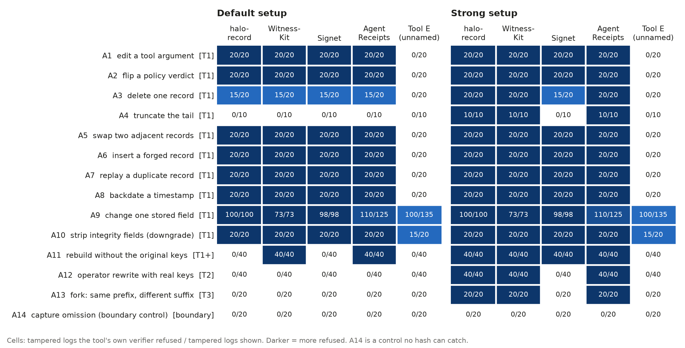

# ReSeal: Do Tamper-Evident Agent Logs Hold Up Against Their Own Operator?

Eleazar Ekhosu

With Apart Research. Research conducted at the AI x Epistemics Research Sprint, November 13 to 15, 2026.

## Abstract

Operators of AI agents increasingly offer "tamper-evident" logs as evidence of what their agents did, and ask auditors and customers to trust a verifier's pass verdict. We test whether that verdict changes when the log is changed. ReSeal records one seeded agent workload through five open-source audit-log tools, applies 14 kinds of tampering at four positions, and asks each tool's own verifier for a verdict, in the default setup and in the strongest documented setup (4,212 trials, plus a 4,172-trial robustness run). We also code each tool's documented claims and compare them with what its verifier did. Four of five tools refuse every edited, reordered, inserted or backdated record. In the default setup all five accept a truncated log, a log rebuilt by the operator with the real keys, and a forked history. Three tools refuse all of these once a head hash, record count or checkpoint is held outside the operator. One tool accepts altered records and logs rebuilt without its keys, against its own headline claim; it is reported unnamed. For the four named tools no specific documented claim failed: of 18 default-setup misses, 12 are disclosed in the documentation and 6 are not mentioned. Benign changes raised no false alarms. A pass verdict from a default setup shows that a log is consistent with itself, not that it is the log that was written. Whoever relies on an agent log should hold the head themselves.

## 1. Introduction

When an AI agent takes a consequential action, the operator's own log is usually the only record of it. A growing set of open-source tools promise to make that record "tamper-evident" or "verifiable": they chain records with hashes, sign them, and ship a verifier that prints a verdict. Customers, auditors and other software are being asked to trust that verdict.

A green "verified" is itself a claim about the world. It is only worth trusting if the verifier would have said something different had the log been changed. That is an empirical question, and it is rarely tested by anyone other than the tool's author, on the tool's own design.

This matters for AI safety because agent logs are evidence. Incident review, oversight of deployed agents and audits against safety commitments all rest on records the audited party holds. The party with the strongest reason to change a log is the operator, who also holds the storage and the signing keys.

**Threat model.** We test five attacker tiers. T1 is an outside editor who changes stored records and does not repair integrity fields. T1+ rebuilds the whole log with the tool's own library but without the original keys. T2 is the operator, who rebuilds the log with the real keys. T3 is an operator who shows a different history that shares a prefix with the real one (a fork). The last tier is a boundary control: the action never reached the recorder. We assume the cryptography is sound and attack only logs we generated ourselves.

**Contributions.**

1. ReSeal, an open harness that records one seeded agent workload through each tool's own API, applies 14 kinds of tampering, and asks the tool's own verifier for a verdict.
2. The first head-to-head measurement of five open-source agent audit-log tools under the same attacks, in their default setup and in their strongest documented setup.
3. A claims-versus-behaviour comparison: each tool's documented claims are coded and set against what its verifier did, giving one Claims Card per tool.
4. Three practical findings on defaults, on tail truncation, and on one verifier that accepts altered records.

## 2. Related Work

**Single-system evaluations.** Agent Flight Recorder [1] combines hash chaining, Merkle batching and on-chain anchoring. It reports that edit, delete, reorder and fork tampering are all detected, at about 48 microseconds of added median latency per event. It injects each attack at ten positions in one log, compares only its own configurations, and leaves comparison against deployed alternatives to future work. We reuse the idea of varying the position, and add truncation, key-holder rewrites and a field-by-field sweep.

**Conceptual limits.** Zhao et al. [2] argue that a claim about an agent is auditable only when its policy, its scope, the records that would settle it and a decision rule are fixed before any verdict. They note that verification authenticates the entries it is given and, without an independent checkpoint, cannot rule out a rewritten chain. Our operator results (A12, A13) measure that point on shipped tools.

**Formats and architectures.** An individual IETF draft [3] defines an agent audit record format in which hash chaining is required while signatures, external timestamps and Merkle batch anchoring are optional. RFC 9943 [4] defines transparency services that issue receipts for signed statements and names non-equivocation as a requirement. These say what a log may contain. They do not test implementations.

**Tool documentation.** The tools we test describe their own limits to very different degrees [5-8]. halo-record separates edited, removed and never-captured records in a claims table, and that split shaped our Claims Card.

**The gap.** We found no study that runs one attack suite across several deployed agent audit-log tools, and none that sets a tool's documented claims against its verifier's behaviour. ReSeal does both.

## 3. Methods

**Tools.** We test five open-source tools that claim tamper-evidence for agent records, ship a verifier that runs offline, and install from PyPI: halo-record 0.2.47, WitnessKit 0.1.0, Signet (signet-auth 0.11.0), Agent Receipts (obsigna 0.16.0), and a fifth tool reported as Tool E. Tool E is unnamed because its result looks like a defect and its maintainer has not been contacted (Appendix A). Agent Flight Recorder was read but not run: our sandbox refused to install code straight from a repository.

**Adapters.** One adapter per tool calls only that tool's public recording and verifying code. A verdict of "accepted" means the verifier vouched for the log. Any refusal, including an explicit "cannot vouch", counts as detected.

**Two setups.** *Default* is what the quick start gives. *Strong* is the strongest verification the tool documents, with the extra state held outside the attacker's reach (Table 1). Attacks never touch that state.

| Tool | Default setup | Strong setup adds |
| --- | --- | --- |
| halo-record | Hash-chain check | Witness checkpoint (record count, head, root) held outside the operator |
| WitnessKit | Chain and signature check with the issuer key pinned | Expected head hash held outside |
| Signet | Chain check and signature check, no pinned key | Agent public key pinned |
| Agent Receipts | Chain and signature check against a given public key | Expected length and final hash held outside |
| Tool E | Per-receipt proof check | Nothing: no stronger offline setup is documented |

*Table 1. What each setup verifies.*

**Workload.** A seeded generator produces 1,000 agent events per run (tool calls, model calls, file writes, approvals, delegations, each with a policy verdict). The same events are recorded through every tool. We use five seeds.

**Attacks.** Fourteen attacks (Figure 1 lists them). A1 to A8 and A10 edit stored records. A9 changes every stored field of one record, one field at a time. A11 and A12 rebuild the whole log through the tool's own recorder, without and with the real keys. A13 is a fork. A14 is the boundary control. Positional attacks run at the first, middle, penultimate and final record.

**Benign controls.** Five harmless changes measure false alarms: a load and re-save through our harness, a file copy, CRLF line endings, re-serialised JSON, and a trailing newline.

**Claims coding.** For each tool we saved the README packaged with the tested version and any security document it links to. Each statement about tampering was coded as property, attacker tier, and strength: *claims*, *claims with setup*, or *disclaims*. No statement means *silent*. Where a headline and a specific statement disagree, the specific one governs the label and the pair is reported separately.

**Labels.** Each tool, property and setup gets one label. *Claim holds*: the documentation claims detection and the verifier detects. *Disclosed limit*: the documentation says the tampering is not detected, or needs extra setup, and it is missed. *Caught, not claimed*: detected although the documentation is silent or disclaims it. *Silent miss*: missed and never mentioned. *Claim not met*: the documentation claims detection and the verifier accepts the log. The repository keeps finer labels, for example whether a claim needed the strong setup.

**Harness checks.** Forty-five tests (38 in the public repository, which lacks the Tool E adapter) assert properties of ReSeal itself: clean logs verify, every attack changes the file, the field sweep changes exactly one field, attacks never touch the original or the outside state, and every coded quote appears word for word in the saved documentation snapshot.

**What did not work.** Signet offers server co-signed receipts, which looked like a stronger setup. Its Python SDK refuses to append them to the audit log (a type error), so they are not part of the audit log's verification and were left out.

## 4. Results

The main run has 4,212 trials: five tools, two setups, five seeds, 1,000 events per log. Every clean log was accepted before any attack ran. Outcomes were identical across the five seeds in every cell, so the counts in Figure 1 are exact for this design, not estimates. No benign control raised a false alarm (0 of 220 applicable trials).

### 4.1 What the verifiers did

**Outside editor (T1).** In the default setup, four tools refused every log with an edited, swapped, inserted, replayed, backdated or stripped record. Tool E accepted every edited, swapped, inserted, replayed and backdated log (0 of 20 each). Deletion depends on position: the same four tools refused a deletion at the first, middle or penultimate record (15 of 15) and accepted deletion of the final record (0 of 5). All five tools accepted a log with its last 1 or last 10 records cut off (0 of 10).

**Rebuild without the keys (T1+).** WitnessKit and Agent Receipts refused all 40 rebuilt logs, because their quick start already takes the issuer's public key. halo-record and Signet accepted all 40. halo-record's chain is unsigned, and its README says so. Signet's default checks use the public key carried inside each receipt.

**Operator (T2 and T3).** In the default setup all five tools accepted a log rebuilt with the real keys (0 of 40) and a forked history (0 of 20). In the strong setup halo-record, WitnessKit and Agent Receipts refused every one (40 of 40, 20 of 20), and also refused truncation (10 of 10). Signet's strongest documented setup, a pinned key, cannot help against the key holder (0 of 40, 0 of 20) and still accepted truncation. Tool E has no stronger setup.

**Field coverage (A9).** halo-record, WitnessKit and Signet refused a change to any stored field. Agent Receipts accepted changes to three fields inside its proof block (creation time, purpose, key reference). Its API reference says the receipt hash excludes the proof block, so this is a design choice, and the receipt's own time and issuer fields are covered. Tool E accepted changes to 7 of its 27 stored fields: agent identifier, index, query hash, response hash, root hash, timestamp and tool name. It also accepted a record with its integrity fields stripped when that record was the first one.

**Boundary control (A14).** No tool flagged an action that was never recorded, as expected.

**Robustness.** A second run with 100-event logs and five new seeds (4,172 trials) gave the same outcome in all 840 cells the two runs share.

*Figure 1. Tampered logs refused by each tool's own verifier, out of tampered logs shown. Left: default setup. Right: strongest documented setup. Darker means more refused.*

### 4.2 Claims versus behaviour

Table 2 sets each tool's documentation against its verifier for eleven kinds of tampering. Appendix C has the full cards with quotes.

| Tool | Claim holds | Disclosed limit | Caught, not claimed | Silent miss | Claim not met |
| --- | --- | --- | --- | --- | --- |
| halo-record | 3 / 5 | 5 / 1 | 3 / 5 | 0 / 0 | 0 / 0 |
| WitnessKit | 6 / 7 | 2 / 0 | 1 / 3 | 2 / 1 | 0 / 0 |
| Signet | 3 / 4 | 4 / 3 | 3 / 3 | 1 / 1 | 0 / 0 |
| Agent Receipts | 3 / 3 | 1 / 0 | 4 / 7 | 3 / 1 | 0 / 0 |
| Tool E | 0 / 0 | 0 / 0 | 0 / 0 | 9 / 9 | 2 / 2 |

*Table 2. Labels per tool, default / strong setup (11 per tool per setup). Disclosed limit: the documentation says the tampering is not detected, or only with extra setup, and it was not. Silent miss: not detected, and the documentation says nothing.*

For the four named tools, no specific documented claim failed. Their 18 default-setup misses split into 12 that the documentation discloses and 6 it does not mention: a forked history (WitnessKit, Signet, Agent Receipts), capture omission (WitnessKit, Agent Receipts) and truncation (Agent Receipts).

Tool E's README says, in paraphrase, that each call gets a proof that cannot be forged or altered afterwards. Its verifier accepted altered records and logs rebuilt without the original keys. These are the only two claims not met.

One headline is stronger than the same project's limits page. Signet's README says "Delete or reorder entries and the SHA-256 hash chain breaks." Its verifier accepted deletion of the final record in 5 of 5 trials. Its security page does say that truncation is "Detectable if expected record count is known", but the audit verifier we called takes no expected count, so keeping and comparing it is left to the user.

### 4.3 Hypotheses

|  | Hypothesis (written 8 to 9 Nov) | Result |
| --- | --- | --- |
| H1 | Defaults catch naive edits but accept an operator rewrite; catching it needs state held outside the operator | Supported. 4 of 5 catch naive edits, 5 of 5 accept the rewrite, 3 of 5 refuse it once outside state is supplied |
| H2 | Truncation and final-record deletion are the most common misses without outside state | Supported. They are the only T1 misses of the four tools that catch edits, and all five miss them |
| H3 | Headline wording claims more than the tool's own limits section | Partly. Clear for Signet and Tool E. halo-record and WitnessKit put the limit next to the headline |
| H4 | At least one verifier accepts a changed stored field or stripped integrity fields | Supported. Tool E (7 fields), Agent Receipts (3 proof-metadata fields, by design) |

*Table 3. Pre-registered hypotheses and outcomes.*

### 4.4 What we take from this

A passing verdict from a default setup means "this file is consistent with itself". It does not mean "this is the log that was written". The difference is one small piece of state held by someone other than the operator: a head hash, a record count or a checkpoint. Three of the five tools can use such state and refuse every rewrite once they have it. None can have it by default, because a quick start has no second party.

Most of the gap is a wording gap. The verifiers of the four named tools do what their detailed documentation says. What a reader of the first screen would expect and what the default setup delivers differ mainly on truncation, forks and operator rewrites.

## 5. Discussion and Limitations

**For people who rely on agent logs.** Ask who holds the head. A verify result that uses only what the operator stores is evidence against an outside editor and nothing more. An auditor who keeps one hash and one record count per checkpoint, outside the operator, gets the stronger guarantee from three of these tools today.

**For tool builders.** Three cheap changes follow from the data. Print what was not checked next to the pass verdict; halo-record already does this. Put the expected head or count in the quick start, because most of the protection rests on it. Say on the first screen that the default cannot see truncation or a fork.

**For standards.** A format that requires chaining and leaves anchoring optional [3] describes the default setups we tested. In our data the externally held checkpoint is the part that changes what a verdict means.

**Limitations.**

- Five tools, one version each, chosen by us from tools with an offline verifier on PyPI. Hosted services and other language SDKs are untested.
- The workload is synthetic. The results describe verifiers, not real deployments.
- The strong setups are our reading of each tool's documentation. We assume the outside state is honest and intact. We do not test an attacker who can replace it, key theft, or the cryptography.
- The claims were coded by one coder, an AI assistant that had already seen pilot results. The plan called for two blind coders and an agreement score. The labels in Table 2, and H3 most of all, are provisional. The counts in Figure 1 do not depend on the coding.
- Outcomes are deterministic. There is no sampling error, and also no claim beyond these versions and these attacks.
- "Detected" means any refusal, including a verifier that fails to parse the tampered file.
- Tool E is unnamed, so its row cannot be reproduced by readers yet (Appendix A).
- We did not measure cost or latency, and we did not build the mapping onto OpenTelemetry spans that our fourth research question planned.

**Future work.** A second, blind claims coder. More tools, including hosted ones and Agent Flight Recorder. Attacks on the outside state itself. A small reference check that any tool could adopt.

## 6. Conclusion

We ran one tampering suite against five open-source agent audit-log tools and compared each verifier with its own documentation. Four of the five catch every naive edit. In the default setup all five accept a truncated log, a log rewritten by the operator, and a forked history. Three of them refuse all of these once a head hash, a count or a checkpoint is held by someone else. One tool accepts altered records outright.

A "verified" result is only as strong as the state the verifier holds that the operator does not. ReSeal makes that testable: a new tool needs one adapter to get its own row and its own Claims Card.

## Code and Data

Code, the claims sheet, saved documentation snapshots and every trial are in the project repository: github.com/0xNexuz/reseal. It leaves out the Tool E adapter until that tool's maintainer has been told (Appendix A). The file results/main/REPORT_NUMBERS.md recomputes every number in this report from the trial file. No dataset with personal data is used; the workload is synthetic.

## Author Contributions

[Eleazar to complete: one or two lines on what you did, for example project direction, review of the claims coding, review and editing of this report.]

## LLM Usage Statement

An AI assistant (Claude, Anthropic) was used throughout: to survey prior work, write the harness code, run the experiments, code the tools' claims, and draft this report. The author directed the project, reviewed the results and the text, and takes responsibility for every claim. Every number in the report was recomputed from the trial file, and every reference was opened and read.

[Eleazar: check this against the exact wording your copy of the template asks for, and change it to match what you actually did.]

## References

[1] L. Bindschaedler, Q. Botha, C. Siebenbrunner. Agent Flight Recorder: Tamper-Evident Audit Trails with On-Chain Anchoring for Long-Horizon Tool-Using Agents. arXiv:2609.01931, 2026. https://arxiv.org/abs/2609.01931

[2] Y. Zhao, J. Li, L. Li, Y. Nian, J. Liu, X. Zhou, X. Hu. Auditable Claims about AI Agents. arXiv:2610.07459, 2026. https://arxiv.org/abs/2610.07459

[3] R. Sharif. Agent Audit Trail: A Standard Logging Format for Autonomous AI Systems. Internet-Draft draft-sharif-agent-audit-trail-09, 26 October 2026. Individual submission, not endorsed by the IETF. https://datatracker.ietf.org/doc/draft-sharif-agent-audit-trail/

[4] H. Birkholz, A. Delignat-Lavaud, C. Fournet, Y. Deshpande, S. Lasker. An Architecture for Trustworthy and Transparent Digital Supply Chains. RFC 9943, June 2026. https://www.rfc-editor.org/rfc/rfc9943.html

[5] halo-record 0.2.47. README as packaged on PyPI, read 13 November 2026. https://github.com/bkuan001/halo-record

[6] WitnessKit 0.1.0. README as packaged on PyPI and SECURITY.md at commit 25dde68, read 13 November 2026. https://github.com/major-matters/witnesskit

[7] Signet (signet-auth 0.11.0). README and docs/SECURITY.md at commit f179591, read 13 November 2026. https://github.com/Prismer-AI/signet

[8] Agent Receipts (obsigna 0.16.0). README as packaged on PyPI, read 13 November 2026. https://github.com/agent-receipts/obsigna

## Appendix A: Limitations and Dual-Use / Ethical Considerations

**What the results establish.** For the versions tested, on logs we generated, each count in Figure 1 is what that tool's own verifier returned. The results do not show how any tool is deployed in practice, and they say nothing about hosted services, other SDKs or later versions. Section 5 lists the limits in full.

**Dual use.** The attacks are ordinary file operations: edit, delete, cut the tail, or rebuild a log with the tool's own library. Anyone who can write to a log can already do them. ReSeal runs them only on logs it creates. A table of what each verifier accepts could still help a dishonest operator choose a weak setup. We think the benefit to auditors, buyers and maintainers is larger, for two reasons. For the four named tools, every miss is either already in the tool's documentation or follows directly from having no state outside the operator. And the remedy is a configuration step, not a secret.

**Disclosure.** Tool E's result looks like a defect and not a documented limit. Its maintainer has not been told at the time of writing. Until that happens we withhold its name, its version, verbatim quotes from its documentation and the steps to reproduce the result, and the public repository leaves out its adapter and its documentation snapshot. Its trial rows are published without name, version or verifier messages. This costs reproducibility for one of five columns. We accept that cost.

**Fairness to maintainers.** Results for the named tools concern documented behaviour of public releases on one date. Documentation changes, so each quote carries a version or commit. Three of the four named tools state most of their limits clearly, and the report says so.

**Risk of over-reading.** Figure 1 is not a ranking. A tool with more dark cells is not safer for a deployer who never holds the outside state. Passing every ReSeal attack also does not make a log trustworthy: no check here can see an action that was never recorded (A14).

**Data and people.** No personal data and no human subjects. The workload is synthetic. Nothing was run against any system other than our own machine.

## Appendix B: Pre-sprint work

The harness was built before the sprint and is marked as pre-existing in the repository (PRE_SPRINT.md and the first commit, dated 11 November 2026).

| When | What | Status |
| --- | --- | --- |
| 8 Nov | Track choice, survey of prior work, research questions and hypotheses | Pre-existing |
| 9 Nov | Workload generator, five tool adapters, attacks A1 to A14, controls, runner, 40 harness tests, claims codebook (empty sheet) | Pre-existing |
| 9 Nov | One pilot run to check the harness works. Its numbers are not reported here | Pre-existing |
| 11 Nov | Template read; one pilot observation re-checked with a standalone script | Pre-existing |
| 13 to 15 Nov | Claims coding, the full experiment reported here, the claims-versus-behaviour analysis, Claims Cards, figure, and this report | Sprint work |

Hypotheses H1 to H4 were written on 8 and 9 November and committed before the reported run. The pilot run means they were not written blind to all data, and the claims were coded by someone who had seen pilot output (Section 5).

## Appendix C: Claims Cards

One card per tool. Counts are tampered logs refused / tampered logs shown, in the default and the strong setup. The verdict column gives the repository's finer label for default / strong.

### halo-record 0.2.47

| Tampering | Attacker | Docs say | Default | Strong | Verdict (default / strong) |
| --- | --- | --- | --- | --- | --- |
| change a record | T1 | detects it | 40/40 | 40/40 | holds / holds |
| remove a record that is not the last | T1 | detects it with a head held by someone else | 15/15 | 15/15 | holds without the setup / holds with setup |
| drop records from the end | T1 | detects it with external witness checkpoints | 0/15 | 15/15 | needs setup (disclosed) / holds with setup |
| swap two records | T1 | detects it | 20/20 | 20/20 | holds / holds |
| add a forged or duplicate record | T1 | nothing | 40/40 | 40/40 | caught (unstated) / caught (unstated) |
| change a record's time | T1 | nothing | 20/20 | 20/20 | caught (unstated) / caught (unstated) |
| strip signature or integrity fields | T1 | nothing | 20/20 | 20/20 | caught (unstated) / caught (unstated) |
| rebuild the log without the original keys | T1+ | does not detect it | 0/40 | 40/40 | disclosed limit / better than stated |
| operator rebuilds the log with the real keys | T2 | does not detect it | 0/40 | 40/40 | disclosed limit / better than stated |
| operator shows a different history | T3 | detects it with external witness checkpoints | 0/20 | 20/20 | needs setup (disclosed) / holds with setup |
| action never reached the recorder | boundary | does not detect it | 0/20 | 0/20 | disclosed limit / disclosed limit |

Statements coded (README, version 0.2.47):

- "Tamper-evident audit trails for AI agents — hash-chained Runtime Records"
- "a chain you hold yourself proves records were not edited, relative to a head someone already holds"
- "given a chain head someone already holds, any edit, reordering, or deletion in the records behind it becomes detectable"
- "only checkpoints held outside the operator prove none were removed"
- "a chain proves internal consistency, not history"
- "an operator could drop a record and re-seal, and the new file would verify"
- "Checkpoints make rewriting committed history detectable"
- "neither the chain nor the witness proves that every real-world action passed through the recorder"

### WitnessKit 0.1.0

| Tampering | Attacker | Docs say | Default | Strong | Verdict (default / strong) |
| --- | --- | --- | --- | --- | --- |
| change a record | T1 | detects it | 40/40 | 40/40 | holds / holds |
| remove a record that is not the last | T1 | detects it | 15/15 | 15/15 | holds / holds |
| drop records from the end | T1 | detects it with expected_head | 0/15 | 15/15 | needs setup (disclosed) / holds with setup |
| swap two records | T1 | detects it | 20/20 | 20/20 | holds / holds |
| add a forged or duplicate record | T1 | detects it | 40/40 | 40/40 | holds / holds |
| change a record's time | T1 | detects it with monotonic-timestamp check | 20/20 | 20/20 | holds without the setup / holds with setup |
| strip signature or integrity fields | T1 | nothing | 20/20 | 20/20 | caught (unstated) / caught (unstated) |
| rebuild the log without the original keys | T1+ | detects it | 40/40 | 40/40 | holds / holds |
| operator rebuilds the log with the real keys | T2 | does not detect it | 0/40 | 40/40 | disclosed limit / better than stated |
| operator shows a different history | T3 | nothing | 0/20 | 20/20 | silent miss / caught (unstated) |
| action never reached the recorder | boundary | nothing | 0/20 | 0/20 | silent miss / silent miss |

Statements coded (README, version 0.1.0; SECURITY.md, commit 25dde68):

- "Every action becomes a signed, hash-chained log entry; any later tamper is detected and located."
- "Alter an entry's content | hash recomputation"
- "Delete an entry | sequence-number gap + broken prev_hash link"
- "Insert a fake entry | downstream seq/link mismatch; a forged entry fails signature/issuer"
- "Reorder entries | sequence-number mismatch"
- "Forge a whole trail | issuer pinning (signer not in trusted_keys)"
- "Truncate / roll back | only with a known expected_head"
- "Backwards-dated entry | optional monotonic-timestamp check"
- "The signing key-holder can re-sign a rewritten chain."
- "Tamper-evident, not tamper-proof"

### Signet (signet-auth 0.11.0)

| Tampering | Attacker | Docs say | Default | Strong | Verdict (default / strong) |
| --- | --- | --- | --- | --- | --- |
| change a record | T1 | detects it | 40/40 | 40/40 | holds / holds |
| remove a record that is not the last | T1 | detects it | 15/15 | 15/15 | holds / holds |
| drop records from the end | T1 | detects it with an expected record count kept by the verifier | 0/15 | 0/15 | needs setup (disclosed) / setup left to the user (disclosed) |
| swap two records | T1 | detects it | 20/20 | 20/20 | holds / holds |
| add a forged or duplicate record | T1 | nothing | 40/40 | 40/40 | caught (unstated) / caught (unstated) |
| change a record's time | T1 | nothing | 20/20 | 20/20 | caught (unstated) / caught (unstated) |
| strip signature or integrity fields | T1 | nothing | 20/20 | 20/20 | caught (unstated) / caught (unstated) |
| rebuild the log without the original keys | T1+ | detects it with pinned public key | 0/40 | 40/40 | needs setup (disclosed) / holds with setup |
| operator rebuilds the log with the real keys | T2 | does not detect it | 0/40 | 0/40 | disclosed limit / disclosed limit |
| operator shows a different history | T3 | nothing | 0/20 | 0/20 | silent miss / silent miss |
| action never reached the recorder | boundary | does not detect it | 0/20 | 0/20 | disclosed limit / disclosed limit |

Statements coded (README and docs/SECURITY.md, commit f179591):

- "Modify any field — tool name, parameters, timestamp, signer — and the Ed25519 signature breaks."
- "Delete or reorder entries and the SHA-256 hash chain breaks."
- "The audit log has not been tampered with (hash chain intact)"
- "Truncate log tail: Detectable if expected record count is known"
- "Modify and re-sign: Requires the private key; public key verification catches if different key used"
- "Hash chain proves ordering and integrity, not completeness — a compromised agent could skip logging"

### Agent Receipts (obsigna 0.16.0)

| Tampering | Attacker | Docs say | Default | Strong | Verdict (default / strong) |
| --- | --- | --- | --- | --- | --- |
| change a record | T1 | detects it | 40/40 | 40/40 | holds / holds |
| remove a record that is not the last | T1 | detects it | 15/15 | 15/15 | holds / holds |
| drop records from the end | T1 | nothing | 0/15 | 15/15 | silent miss / caught (unstated) |
| swap two records | T1 | detects it | 20/20 | 20/20 | holds / holds |
| add a forged or duplicate record | T1 | nothing | 40/40 | 40/40 | caught (unstated) / caught (unstated) |
| change a record's time | T1 | nothing | 20/20 | 20/20 | caught (unstated) / caught (unstated) |
| strip signature or integrity fields | T1 | nothing | 20/20 | 20/20 | caught (unstated) / caught (unstated) |
| rebuild the log without the original keys | T1+ | nothing | 40/40 | 40/40 | caught (unstated) / caught (unstated) |
| operator rebuilds the log with the real keys | T2 | does not detect it | 0/40 | 40/40 | disclosed limit / better than stated |
| operator shows a different history | T3 | nothing | 0/20 | 20/20 | silent miss / caught (unstated) |
| action never reached the recorder | boundary | nothing | 0/20 | 0/20 | silent miss / silent miss |

Statements coded (README, version 0.16.0):

- "cryptographically signed, hash-chained records that can't be quietly altered after the fact"
- "with cryptographic proof the log hasn't been tampered with after the fact"
- "The receipt chain shows exactly which actions it took, in what order"
- "Anyone with code execution in the agent can forge receipts."

### Tool E (unnamed)

Default and strong setup are the same: the SDK's own receipt check. It documents no stronger offline setup.

| Tampering | Attacker | Docs say | Default | Strong | Verdict (default / strong) |
| --- | --- | --- | --- | --- | --- |
| change a record | T1 | detects it | 0/40 | 0/40 | claim not met / claim not met |
| remove a record that is not the last | T1 | nothing | 0/15 | 0/15 | silent miss / silent miss |
| drop records from the end | T1 | nothing | 0/15 | 0/15 | silent miss / silent miss |
| swap two records | T1 | nothing | 0/20 | 0/20 | silent miss / silent miss |
| add a forged or duplicate record | T1 | nothing | 0/40 | 0/40 | silent miss / silent miss |
| change a record's time | T1 | nothing | 0/20 | 0/20 | silent miss / silent miss |
| strip signature or integrity fields | T1 | nothing | 15/20 | 15/20 | silent miss / silent miss |
| rebuild the log without the original keys | T1+ | detects it | 0/40 | 0/40 | claim not met / claim not met |
| operator rebuilds the log with the real keys | T2 | nothing | 0/40 | 0/40 | silent miss / silent miss |
| operator shows a different history | T3 | nothing | 0/20 | 0/20 | silent miss / silent miss |
| action never reached the recorder | boundary | nothing | 0/20 | 0/20 | silent miss / silent miss |

Statements coded, in paraphrase: each call gets a proof that cannot be forged or altered afterwards; tamper-evident audit trails.
